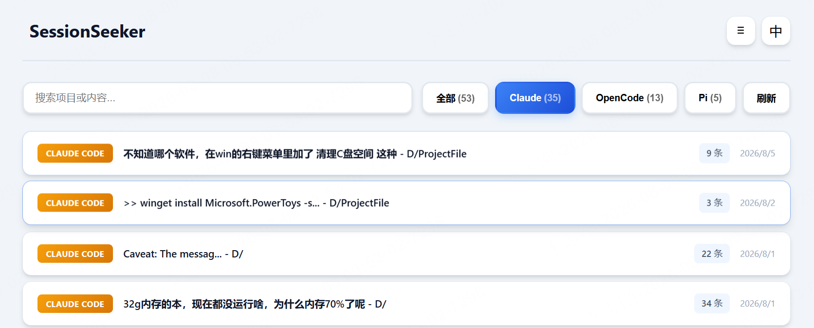

# Session Manager  

A lightweight manager for AI coding sessions. Browse, search, restore, and delete sessions from Claude Code, OpenCode, and Pi.

## Features

-   **Unified View** — Browse sessions from all 3 AI tools in one place
-   **Search** — Full-text search across all sessions
-   **Filter** — Filter by tool type (Claude / OpenCode / Pi)
-   **Restore** — Copy resume commands to continue any session
-   **Export** — Export sessions as Markdown
-   **List/Card View** — Toggle between list and grid layouts

## Supported Tools

| Tool | Session Source |
|------|----------------|
| Claude Code | `~/.claude/projects/**/*.jsonl` |
| OpenCode | `~/.local/share/opencode/opencode.db` |
| Pi | `~/.pi/agent/sessions/**/*.jsonl` |

## Quick Start

1. Make sure **Python 3.10+** is installed
2. Run `start.bat` (Windows) or `python server.py`
3. Open http://localhost:5690

## Requirements

- **Python 3.10+** (no pip dependencies needed)
- Modern browser (Chrome/Edge/Firefox)

## Resume Commands

| Tool | Command |
|------|---------|
| Claude Code | `claude --resume <session-id>` |
| OpenCode | `opencode -s <session-id>` |
| Pi | `pi -s <session-id>` |

## License

MIT
